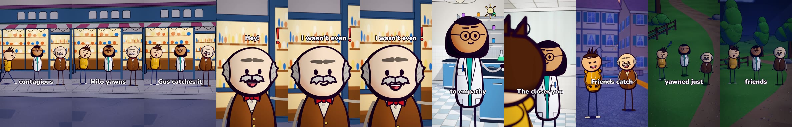
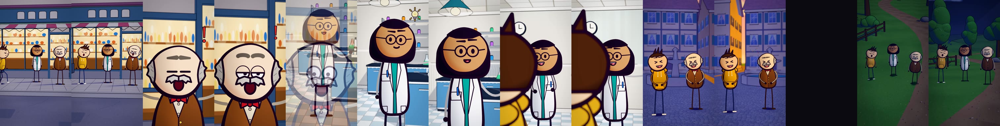

# Writing a Short as a storyboard

From Stage 1E on, a new video is **data, not code**. You describe the shots: who is in each one, where they stand, what
they do and how the camera moves. The engine then builds the whole film, with the same look, characters and sets as
every other video.

```
storyboard (data)  ->  validate (npm run test:story)  ->  compile  ->  Short-<id> composition  ->  cloud render farm
```

| File | Job |
|---|---|
| `animation-studio/src/studio/story/types.ts` | the storyboard format (what you can write) |
| `animation-studio/src/studio/story/validate.ts` | finds mistakes and checks 9:16 framing before any render time is spent |
| `animation-studio/src/studio/story/compile.ts` | turns the data into camera moves, transitions and per-frame acting |
| `animation-studio/src/studio/story/Short.tsx` | the one generic composition used by every storyboard |
| `animation-studio/src/studio/stories/*.ts` | the storyboards themselves; register each one in `stories/index.ts` |

The first video built this way is the "yawn" demo, `stories/yawn-demo.ts`. Run 5 produced the silent 18-second version (release `video-Short-yawn-demo-run5`). Run 7 is the narrated 22.3-second version, voiced by George, with captions and lip-sync (release `video-Short-yawn-demo-run7`).





## Making a new video
1. Copy `stories/yawn-demo.ts` to a new file and give it a new `id`.
2. Add it to the `STORIES` list in `stories/index.ts`. It automatically becomes the composition `Short-<id>`.
3. Run `npm run test:story`.
   - It must print `all storyboards valid`.
   - Each error names the shot and the problem, for example `shot 3 (lab): milo stands on unknown mark "sofa" (marks: a, b, c, bench, island, hood)`.
4. Make the narration. Run `npm run voice -- <id>` for a dry run that lists the new lines and their credit cost, then `npm run voice -- <id> --generate`. Lines already generated are never paid for again. See [VOICE.md](VOICE.md).
5. Run `npm run test:story` again, now with the real word timings.
6. Render it in the cloud. Commit `render-request.json` with `"composition": "Short-<id>"`. The soundtrack `audio/Short-<id>.mp3` is added automatically. See [CLOUD_RENDERING.md](CLOUD_RENDERING.md).

## The format

```ts
{
  id: "yawn-demo",
  cast: { milo: "milo", juno: "juno", gus: "gus", waiter: { extra: 7, era: "modern" } },
  shots: [
    { say: "Milo yawns, and seconds later, Gus catches it.", set: "city", light: "day",
      camera: { move: "frame", on: ["milo", "juno", "gus"], size: "full", from: 4, height: 1.5 },
      transition: "cut",
      actors: [
        { who: "milo", at: "kerb", walk: { to: "a", t0: 0, t1: 1.3 }, beats: [{ word: "yawns", act: "sleepy" }] },
        { who: "gus", at: "c", act: "happy", beats: [{ word: "catches", act: "sleepy" }] },
      ],
      fx: [{ kind: "idea", on: "gus", word: "catches" }],
      kicks: [{ word: "catches" }],
      note: "script line for this shot" },
  ],
}
```

All times are in **seconds from the start of the shot**. Anything timed can be anchored to a spoken word instead: `{ word: "catches" }` lands 2 frames before that word.

### Shot fields
| Field | Meaning |
|---|---|
| `say` | what is said over the shot: a string (voice-over), or `{ text, who?, voice?, gap? }` lines. `who: "gus"` makes Gus say it, with lip-sync |
| `dur` | length in seconds. With `say`, the shot lasts as long as its lines and `dur` is only a minimum, so you can leave it out. Without `say`, it's required. 1.5–4 s suits Shorts |
| `hold` | seconds held after the shot's last word (default 0.2; 0.45 on the last shot) |
| `set` | `home`, `classroom`, `office`, `lab`, `city`, `oldtown`, `nature`, or a theme's set (`shipDeck`, `island`) |
| `light` | `day`, `golden` or `night` outdoors; `interior` or `interiorCool` indoors. If left out, the set's own default is used |
| `transition` | how this shot begins: `cut` (default), `fade` (8-frame crossfade), `flash` (white flash) or `dip` (a quick dip to black) |
| `fx` | reaction marks that follow a character's head (lean, tilt, laugh). `stars` orbits the crown (dizzy). The 16 kinds are listed in [LIBRARY.md](LIBRARY.md) |
| `kicks` | impact camera shakes (times or `{ word }`) |
| `props` | story props for this shot: `[{ id: "barrel", at: "c", offset: [0.6, 0.4], yaw: 20, scale?, variant? }]`. The ids are in `docs/ASSETS.md`. The validator stops a prop from standing on an actor, warns when one overlaps the set and fails one that is never in frame. **Animated props** (those with a rig, e.g. `robotArm`): `follow: { who }` reaches for that actor's held-out palm (gesture `operate`); `drive: { who, delay, changes: [{ word, delay }] }` replays the actor's control strokes, late by `delay` seconds |
| `diagram` | an animated explainer panel: `{ kind: "forecast" | "prediction" | "contrast" | "delay", with: "juno", place?: "above" | "side", size?, steps: [{ word }, ...] }`. Each step lands on its word; every diagram shows its starting picture from the shot's first frame (never a blank panel). `prediction` is your own predicted touch only (the meter ends at zero); `contrast` compares it with someone else's unexpected touch. `place: "above"` stacks the panel over the presenter (best for 9:16). Name `"diagram"` in the camera's `on` list to frame it. It draws on top of the set and the captions avoid it |
| `crowd` | background extras: `{ count: 6, era: "medieval", around?, radius?, acts?, seed? }`. They're placed on clear floor (generated floor maps), inside the frame, behind the cast and spread out. The validator says if fewer fit |
| `mood` / `ambience` / `sfx` | sound controls, see [SOUND.md](SOUND.md) |

Story-level fields:
- `voice` sets the voice preset for every line. The default is George, the channel narrator.
- `voices` gives specific speakers their own voices, for example `{ gus: "brian" }`.
- `captions: false` turns captions off. They are on by default.

### Camera moves
In camera moves you name **characters**, not coordinates. The engine works out the camera position for the 9:16 frame.

| Move | Example |
|---|---|
| a set's designed view | `{ move: "view", view: "wide" }` or `establish` (slow drift) |
| frame some characters | `{ move: "frame", on: ["milo","juno"], size: "medium", from: 10 }`. `on` may also name a story prop (`"robotArm"`) or `"diagram"` |
| push in / pull out | `{ move: "pushIn", on: ["juno"], size: "full", to: "medium" }` |
| close-up | `{ move: "closeUp", on: "gus", punch: true }` |
| low hero / high angle | `{ move: "lowHero", on: "milo" }` / `{ move: "highAngle", on: ["milo","gus"] }` |
| over the shoulder | `{ move: "overShoulder", over: "milo", at: "juno" }`. Give Milo `back: true` |
| orbit | `{ move: "orbit", on: ["milo","gus"], fromDeg: [-14, 14] }` |
| crane down | `{ move: "crane", on: [...], heights: [5, 1.5] }` |
| dutch tilt | `{ move: "dutch", on: ["gus"], roll: 0.14 }` (roll in radians) |
| follow a walker or runner | `{ move: "follow", on: "milo", size: "full", from: 20 }` |

The camera options work like this:
- **`size`** is one of `wide`, `full`, `medium`, `close` or `extreme`.
- **`from`** is the camera angle around the characters, in degrees.
- **`height`** is the camera height in metres.

### Actor fields
| Field | Meaning |
|---|---|
| `at` | a set mark (`a`, `b`, `c`, `kerb`, `sofa`...; see [LIBRARY.md](LIBRARY.md)) or `[x, floorY, z]` |
| `act` | one of 26 acting presets (face plus body), for example `explain`, `shock`, `laugh`, `sleepy` or `idea` |
| gestures to know | `tickleSelf` (elbow up, other hand tickling the armpit), `tickle` (reach and tickle someone, with `reach`), `operate` (one hand on a control, the other palm held out), `read` (both hands hold an open item, e.g. `hold: "openBook"`, eyes down). Gesture changes ease automatically over 0.15-0.4 s. All 26 are on the character sheet page `gestures-milo` |
| `face` / `gesture` | override the preset's expression or hands |
| `beats` | changes during the shot: `{ t, act?, face?, gesture? }`. Expression changes hide behind an automatic blink |
| `talk` | speaking spans `[[start, end]]` without audio. Voiced lines (`say` with `who`) set the mouth from the real words automatically |
| `nod` / `shake` | start times of head nods and head shakes |
| `walk` | walks in profile from `at` to `to` between `t0` and `t1` (or `from: { word }`, `until: { word }`); add `mode: "run"` to run, with footsteps following automatically |
| `reach` | with the `tickle` gesture: the hands land on this actor's flank, wherever they stand. Stand the tickler about 0.5 m beside the target and slightly in front, so the hands draw over the target |
| `moves` | body motion on top of the acting, on words: `squirm` (wriggling with laughter), `stagger` (nearly falls over, `away` from someone; the camera frames the lean), `hop`, `recoil`. `{ word, kind, dur?, away?, dir?, amount? }` |
| `drive` | the `operate` gesture's control strokes from a moment: `{ word, hz? }`. An animated prop can replay them |
| `hold` | a hand-held item such as `"map"`, `"book"` or `"telescope"`, drawn in the character's hand in front of the chest. Gestures that raise the hand (`raiseHand`, `pointUp`, `cheer`) show it off overhead. A beat `{ word: "facts", hold: "book" }` swaps the item, and `hold: null` puts it away |
| `facing` | by default each character turns toward the nearest other character. Can also be `"camera"`, `"toward:gus"`, `-1`, `0` or `1` |
| `back` | seen from behind (the near character in an over-the-shoulder shot) |
| `idle` | how much idle life (breathing, glances): default 1; `0` keeps them still |

## What the engine does for you
- **Framing:**
  - Cameras frame characters where they settle (at the end of a walk), so walk-ins enter the frame naturally.
  - The slow "breathing" push-in of a held shot totals at most 8%, so a fitted group stays in frame to the last frame.
- **Clear sight lines:** a lamp post, tree or bench that would stand between the lens and the cast is left out of that film's build of the set (outdoor sets).
- **Acting:**
  - Characters face the nearest other character.
  - Expression changes hide behind an automatic blink.
  - Effects pop up beside the head on the side facing the frame centre, follow the head's real position, and switch sides rather than leave the frame.
  - A speaker keeps an authored action gesture (thumbs up, pointing, holding, tickling) while their mouth talks.
- **Over-the-shoulder:** the shot is solved for the narrow vertical frame. The near character's back fills the outer third and the far character's face sits just off centre.
- **Transitions and determinism:** the incoming shot's camera starts early under a crossfade, so both halves of the fade move. Everything is a pure function of the frame number, so chunked cloud renders join without seams.

- **Narration:**
  - Shots are sized to their lines, with no dead air between them.
  - Captions show 1–3 words at a time, on the words.
  - Speaking characters' mouths open on each syllable.
  - Reactions land 2 frames before their word.
  - Everything is timed from the real audio, within 2 frames. See [VOICE.md](VOICE.md).

## What the validator checks
- **Unknown names:** cast, sets, lights, marks, acts, faces, gestures, effects and views.
- **Staging conflicts:** two actors on one mark; a camera aimed at someone who isn't in the shot.
- **Timing:** beats, talk spans, walks and effects that fall outside their shot.
- **Narration:**
  - unknown voice presets;
  - a speaker who isn't in the shot or the cast;
  - a word anchor the shot's lines don't actually say;
  - lines not generated yet (timing estimated);
  - a pace outside 2.6–4.6 words/s.
- **Lighting:** an indoor light used on an outdoor set, or the reverse.
- **Vertical framing:** it solves the real camera at the start, middle and end of every shot and checks that each subject's head is fully inside the 1080x1920 frame. Walkers are checked once they arrive. In over-the-shoulder shots, the near character's shoulder must fill at least 15% of the frame width.

- **Staging (run on what the director actually draws, every 0.2 s):**
  - a hand out of the top of the frame, or out of the side when the hand is the action (tickling, operating, pointing, waving, thumbs up, holding...); a talking or shrugging hand cut by a close-up is only a warning;
  - an effect off screen;
  - a camera subject's face hidden behind a nearer character (an actor still walking in is exempt);
  - a non-subject figure filling more than 25 % of the frame in the foreground (warning);
  - a story prop never in frame; a diagram cut by the frame edge; an animated prop that can't reach the hand it follows.

The test also feeds the validator deliberately broken storyboards to make sure it catches each kind of mistake (16 cases, including one for each staging check).
